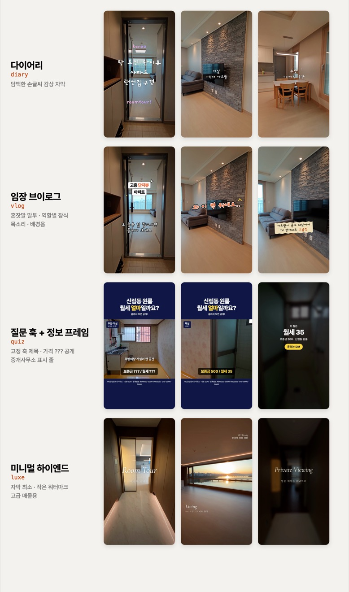

# Roomtour Shorts

**집 안을 걸으며 찍은 영상 하나를, 자막·목소리·배경음이 들어간 부동산 릴스로 만듭니다.**

사람 없이 1인칭으로 찍은 룸투어·매물 영상을 넣으면 1080×1920 세로 MP4가 나오는 Codex 스킬입니다. Codex가 영상을 장면별로 보고, 고른 버전에 맞춰 한국어 자막을 쓰고, 원하면 AI 목소리와 배경음까지 붙여 줍니다.

**버전 1.1.0** · **Codex (Claude Code에서도 동작)** · **Windows · macOS** · **API 키 없이 사용**

[빠른 시작](#빠른-시작) · [4가지 버전](#4가지-버전) · [처음 써 보기](#처음-써-보기) · [자주 묻는 질문](#자주-묻는-질문) · [설치 자세히](INSTALL.md) · [이용 조건](#이용-조건)



*직접 촬영한 아파트·빌라·고급아파트 영상으로 만든 결과입니다. 가격과 중개사무소 정보는 예시 값입니다.*

## 빠른 시작

**1. 준비물 설치** (이미 있으면 건너뛰기)

| | Windows (PowerShell) | macOS (터미널) |
|---|---|---|
| Node.js | `winget install -e --id OpenJS.NodeJS.LTS` | `brew install node` |
| ffmpeg | `winget install -e --id Gyan.FFmpeg` | `brew install ffmpeg` |
| Python | `winget install -e --id Python.Python.3.12` | `brew install python` |

설치 후 PowerShell·터미널을 새로 엽니다.

**2. 한 줄 설치**

Windows PowerShell:
```powershell
powershell -ExecutionPolicy Bypass -c "irm https://raw.githubusercontent.com/eziwork/eziwork-roomtour-shorts/main/install.ps1 | iex"
```

macOS 터미널:
```sh
curl -fsSL https://raw.githubusercontent.com/eziwork/eziwork-roomtour-shorts/main/install.sh | bash
```

스킬을 Codex 스킬 폴더에 놓고, 준비물을 점검하고, 무료 음성 엔진(약 550MB)까지 설치합니다. 기존에 설치한 폴더가 있으면 지우지 않고 `.bak-날짜`로 보관합니다.

**3. Codex를 다시 열고 입력**
```text
$roomtour-shorts 이 매물 영상 릴스로 만들어줘
```

## 4가지 버전

| 버전 | 이런 영상에 | 화면 |
|---|---|---|
| **다이어리** `diary` | 담백한 「랜선집구경」 | 둥근 손글씨 감상 자막, 장식 없음. 색 4가지(보라·하늘·세이지·크림골드) |
| **임장 브이로그** `vlog` | 방 보러 다니는 사람의 혼잣말 | 자막 역할마다 장식이 바뀜(정보 박스·외곽선 손글씨·리액션·마스킹테이프·말풍선), 스티커, 타이핑 |
| **질문 훅** `quiz` | "이 집 월세 얼마일까요?" | 위아래 띠에 고정 제목, 가격을 `???`로 가렸다가 공개, 중개사무소 표시 줄 |
| **미니멀 하이엔드** `luxe` | 고급 매물 | 자막 최소, 영문 이탤릭 표지, 짧은 방 이름, 작은 브랜드 워터마크 |

## 처음 써 보기

1. Codex에 `$roomtour-shorts 이 매물 영상 릴스로 만들어줘`라고 입력합니다.
2. 영상 경로를 달라고 하면 붙여 넣습니다.
   - Windows: 영상 파일을 **Shift+우클릭 → "경로로 복사"** → 채팅에 붙여넣기
   - Mac: 영상 파일을 **채팅창으로 끌어다 놓기**
3. Codex가 영상을 1초 간격으로 훑어본 뒤 몇 가지를 묻습니다. 고르거나 직접 적으면 됩니다.
   - 버전 (위 4가지)
   - 목소리 (없음 / 여자 / 남자)
   - 배경음 (알아서 찾기 / 안 넣기 / 내 파일)
   - 매물 정보 (가격·평형·지역, 넣지 않음)
   - 강조할 특징 (영상에서 찾은 것 중 고르기)
   - 버전별로 필요한 것 (예: 질문 훅은 중개사무소 정보, 하이엔드는 브랜드명)
4. 몇 분 뒤 `roomtour/output/`에 MP4가 생깁니다.
5. 고칠 곳은 말로 하면 됩니다. "3번째 자막 바꿔줘", "배경음 2번으로", "목소리 남자로", "색 하늘로".

질문을 건너뛰고 한 번에 말해도 됩니다.
```text
$roomtour-shorts C:\Users\me\Videos\신림동원룸.mp4 릴스로 만들어줘.
버전은 quiz, 목소리는 남자, 배경음은 알아서.
신림동 원룸, 보증금 500 / 월세 35. 끝에 "문의는 DM 주세요".
```

**어떤 영상이 잘 되나요?** 사람이 나오지 않고 집 안을 천천히 걸으며 찍은 20~60초 영상이 가장 좋습니다. 가로 영상도 세로로 바꿔 줍니다. 60초가 넘으면 줄일지 물어봅니다.

## 자주 묻는 질문

**API 키나 유료 결제가 필요한가요?**
아니요. 목소리(Supertonic)는 내 컴퓨터에서 돌아가고, 배경음은 키 없는 공개 API에서 찾습니다. 유료 Gemini 목소리는 원할 때만 고를 수 있습니다.

**가격이나 정보를 지어내지는 않나요?**
알려 준 정보만 씁니다. 영상만 보고 "신축", "한강뷰", "30평대"처럼 단정하지 않고, 가격을 모르면 "가격은 댓글로"처럼 처리합니다.

**배경음 저작권은 괜찮나요?**
상업적으로 쓸 수 있는 CC0·CC BY 연주곡만 가져옵니다. CC BY 곡은 출처 표시가 조건이라, 프로젝트의 `assets/bgm-credit.txt`에 남는 출처 줄을 게시물 본문에 넣어 주세요. 배경음 없이 만들고 인스타 앱에서 음악을 붙여도 됩니다.

**AI 목소리라고 밝혀야 하나요?**
음성 엔진(Supertonic)의 라이선스가 AI 생성 콘텐츠임을 밝히도록 요구합니다. 영상 화면에는 표시를 넣지 않으니, 게시물 본문 등에 직접 표기해 주세요.

**Codex가 "실행해도 될까요?"라고 물어요.**
인터넷을 쓰거나(처음 받기, 배경음 검색) 크롬을 띄우는(검사·렌더링) 단계에서 Codex 안전장치가 묻는 것입니다. 허용하면 됩니다.

**설치가 잘 됐는지 확인하고 싶어요.**
스킬 폴더에서 `python scripts/selftest.py`를 실행하면 시험 영상으로 네 버전을 모두 만들어 봅니다(1~2분). `자체 점검 통과`가 나오면 됩니다.

**공인중개사 매물 광고에 써도 되나요?**
됩니다. 다만 매물 광고에는 공인중개사법의 표시 의무(중개사무소 명칭·소재지·연락처·등록번호, 중개사 성명 등)가 적용될 수 있습니다. 질문 훅 버전은 중개사무소 표시 줄을 넣을 수 있고, 다른 버전은 엔딩 카드에 넣을 수 있습니다.

## 무엇을 해 주나요?

| 단계 | 하는 일 |
|---|---|
| 영상 분석 | 1초 간격 장면표를 만들고 방마다 보이는 것을 정리 (가로 영상은 대상을 따라가며 세로로 변환) |
| 자막 | 장면 시간에 맞춰 버전별 말투로 작성 |
| 목소리 (선택) | 무료 Supertonic 여자·남자, 또렷한 릴스 톤. 자막과 따로 2~3칸에 한 번만 말함 |
| 배경음 (선택) | 버전 분위기에 맞는 연주곡 자동 검색, 목소리가 나올 때 자동으로 작아짐 |
| 렌더링 | HyperFrames로 MP4 출력, 자막 잘림·대비 검사 |

## 폴더 구성

| 경로 | 내용 |
|---|---|
| `SKILL.md` | Codex가 따르는 작업 순서 |
| `install.ps1` · `install.sh` | 한 줄 설치 |
| `scripts/` | `doctor.py` 점검·설치, `new_project.py` 영상 분석, `build.mjs` 화면 생성, `tts.py` 목소리, `bgm.py` 배경음, `reframe.py` 가로→세로, `selftest.py` 자체 점검 |
| `references/` | 버전별 스타일 가이드, 레퍼런스 분석(패턴 정리), spec 형식, 예시 |
| `assets/fonts/` | Pretendard, Gaegu, Noto Serif KR, Cormorant Garamond (모두 OFL) |

## 이용 조건

[LICENSE.md](LICENSE.md)와 [THIRD_PARTY_NOTICES.md](THIRD_PARTY_NOTICES.md)를 확인하세요. 만든 영상의 게시·판매는 자유롭고, 스킬 수정·무료 재배포도 됩니다. 스킬 자체를 유료로 재판매할 수는 없습니다. 글꼴·음성 모델·배경음은 각 권리자의 조건을 따릅니다.
